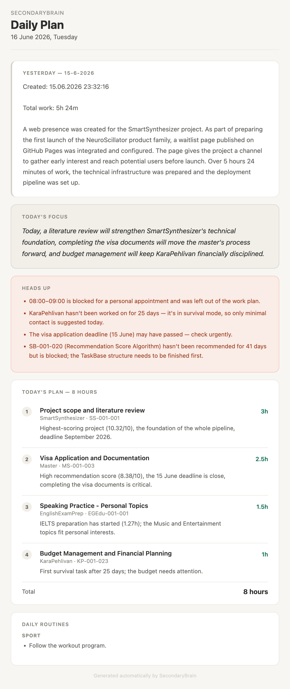

## Overview

**Autonomous Work Logger** (internally, *SecondaryBrain*) removes manual journaling and task planning from my day. It collects what I actually worked on, from tracked time and code commits to calendar events and edited documents, and uses Claude to turn it into a written daily log, a recommended plan for the next morning and a weekly strategy review.

Everything runs on **Google Apps Script** with scheduled triggers, so it works in the background without a server. A Google Sheet is the single source of truth for projects and tasks, and the written outputs land in my **Obsidian** vault as Markdown notes.

A real weekly report (translated from Turkish): a reward for the week, totals, charts, Claude's review of the week, and its note on whether to change the recommendation weights.

## How it works

| When | What happens |
| --- | --- |
| Every morning, 08:00 | Task scores are recalculated, a 6–7 hour plan is proposed and emailed |
| Every evening, 22:00 | The day's activity is collected, summarized by Claude and written to Obsidian |
| Every Sunday, 23:00 | The whole week is analysed and a strategy report with charts is emailed |

## Morning: a scored daily plan

Each project gets a **recommendation score** from three signals: its **strategic value**, the **urgency of its deadline** (rising as the deadline gets closer) and its **recent activity**. The score is computed in code, so it stays transparent and reproducible.

Claude then receives the scored tasks, my goals and progress notes, the last two weeks of daily logs and today's calendar, and proposes a realistic plan for the day. The plan is saved back to the sheet and sent as a morning email.

A real morning email (translated from Turkish): yesterday's summary, today's focus, warnings, and an 8-hour plan with the reason behind each task.

## Evening: an automatic daily log

At night the system gathers the day's evidence:

- time entries from **Clockify**,
- commits and changed files from **GitHub**,
- events from **Google Calendar** and edited files from **Google Drive**.

Claude turns this into a readable daily summary and per-project progress notes, which are written into the Obsidian vault through the GitHub API. Actual time spent is also written back to the task list, so the difference between *planned* and *done* is tracked over time.

## Weekly: strategy review that tunes itself

Every Sunday the system builds a dashboard of where the time actually went, then asks Claude to compare the week against my long-term goals. The review is saved to Obsidian and sent as an HTML email with charts (like the one at the top of this page). Claude also picks a small reward for the week from a list I keep, each with its own image.

The review also closes the loop: Claude suggests new **weights** for the morning recommendation score, and the system updates its own configuration, so next week's plans reflect what this week revealed.

## Task generation

Projects are described in plain Markdown files in Obsidian (scope, goals, constraints, current progress). From these, Claude generates and updates a structured task list with estimated hours, difficulty and dependencies. University courses are handled as their own project type, with prompts focused on modules and lessons. Tasks and projects are kept in sync with Clockify automatically, so time can be tracked against them.

## Tech stack

| Tool | Role |
| --- | --- |
| Google Apps Script | Scheduling and orchestration |
| Claude API | Daily summaries, plans, task generation, weekly analysis |
| Clockify API | Time tracking |
| GitHub API | Commit history, and writing notes into the Obsidian vault |
| Google Sheets | Projects, tasks and settings (single source of truth) |
| Google Calendar · Drive | Daily context |
| Gmail | Morning plans and weekly reports |
| Obsidian | Daily logs, project notes and strategy reports |
