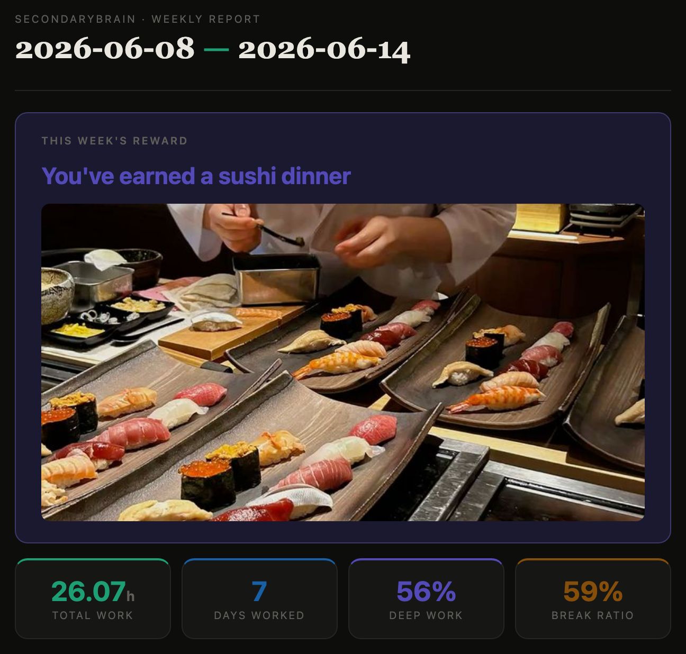
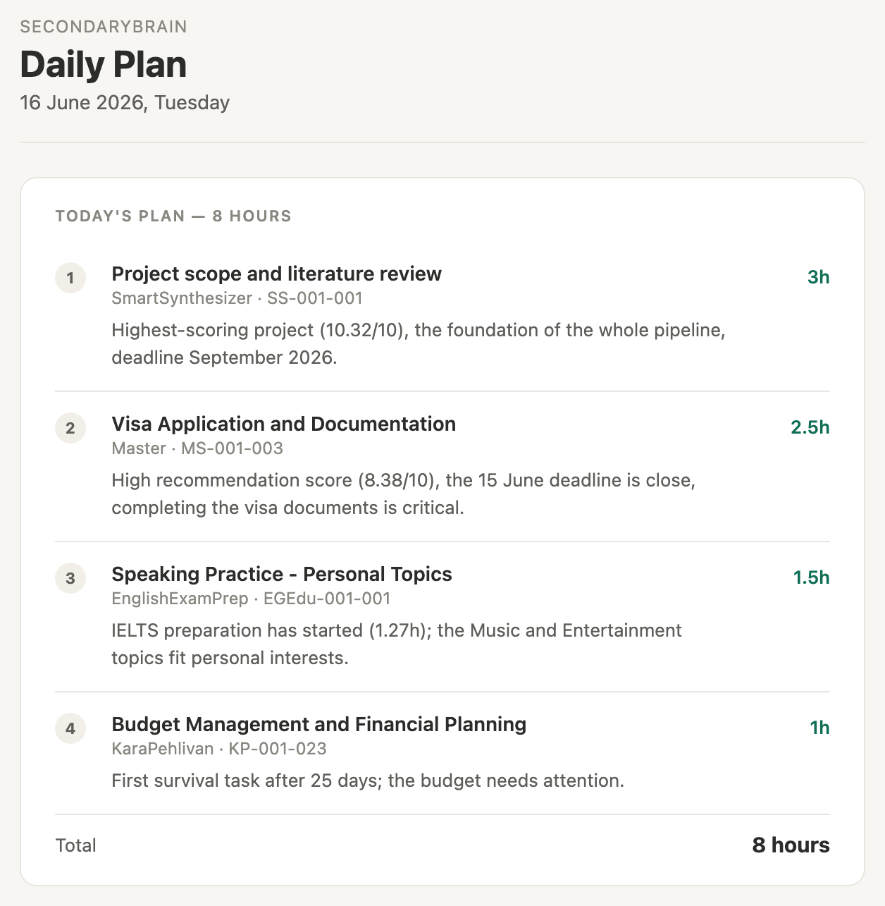
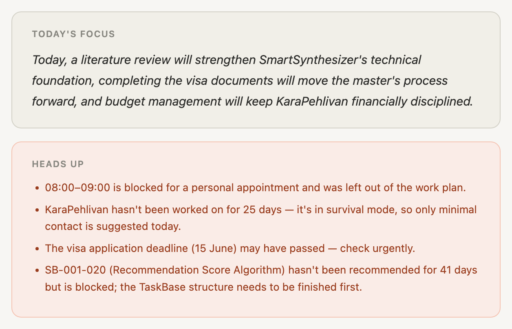
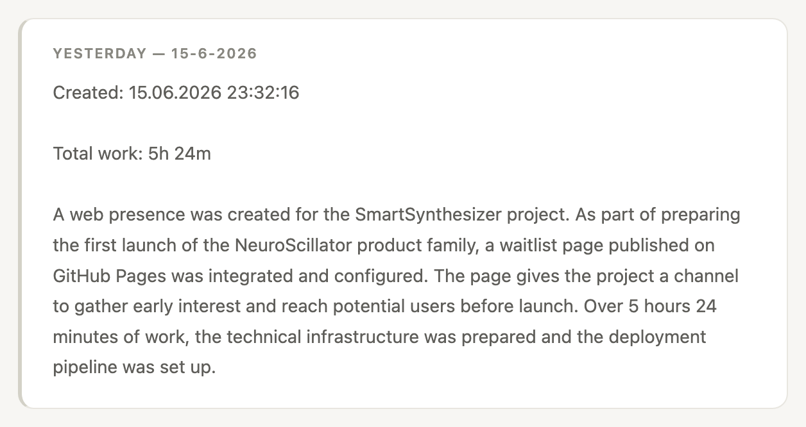
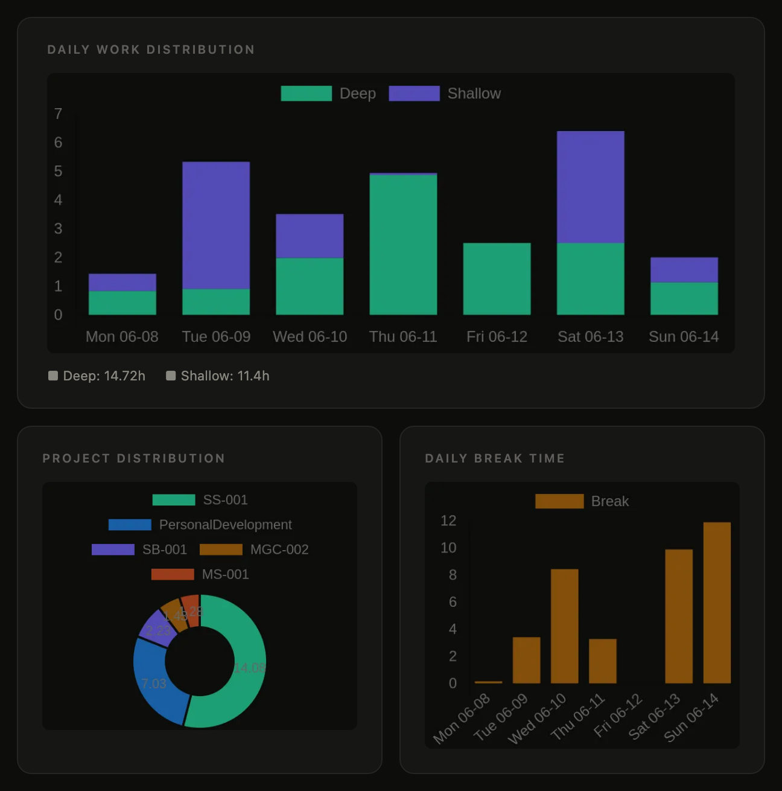
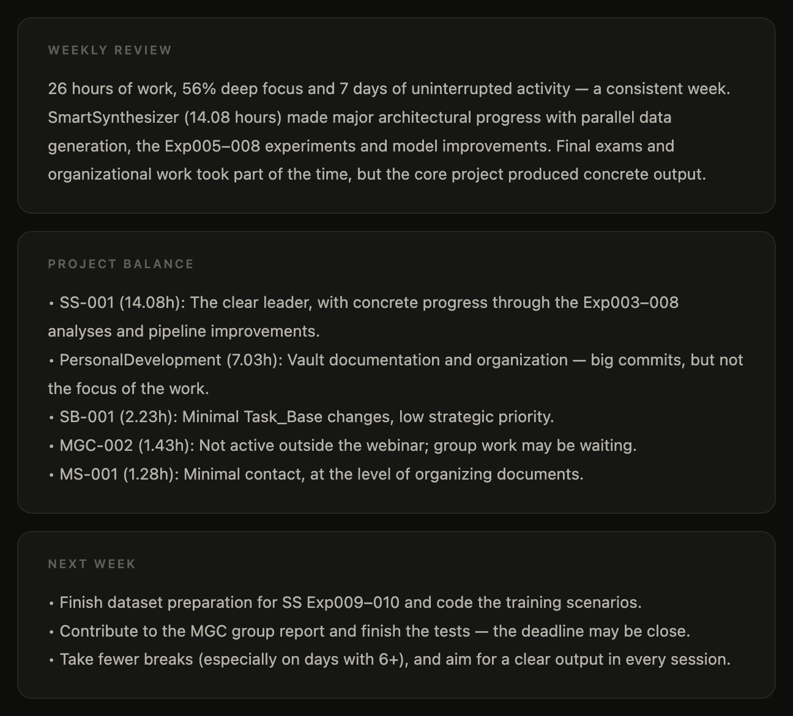
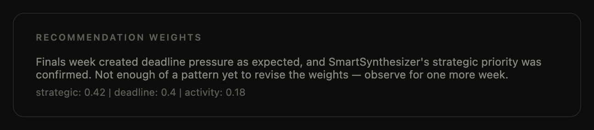

## Overview

**Autonomous Work Logger** (internally, *SecondaryBrain*) removes manual journaling and task planning from my day. It collects what I actually worked on, from tracked time and code commits to calendar events and edited documents, and uses Claude to turn it into a written daily log, a recommended plan for the next morning and a weekly strategy review.

Everything runs on **Google Apps Script** with scheduled triggers, so it works in the background without a server. A Google Sheet is the single source of truth for projects and tasks, and the written outputs land in my **Obsidian** vault as Markdown notes.

The top of a real weekly report: the week's reward and its totals. All emails on this page are real outputs, translated from Turkish.

## How it works

| When | What happens |
| --- | --- |
| Every morning, 08:00 | Task scores are recalculated, a 6–7 hour plan is proposed and emailed |
| Every evening, 22:00 | The day's activity is collected, summarized by Claude and written to Obsidian |
| Every Sunday, 23:00 | The whole week is analysed and a strategy report with charts is emailed |

## Morning: a scored daily plan

Each project gets a **recommendation score** from three signals: its **strategic value**, the **urgency of its deadline** (rising as the deadline gets closer) and its **recent activity**. The score is computed in code, so it stays transparent and reproducible.

Claude then receives the scored tasks, my goals and progress notes, the last two weeks of daily logs and today's calendar, and proposes a realistic plan for the day. Every task comes with its time budget and the reason it was chosen:

The morning email's plan: four tasks, eight hours, each with the reason it made the list.

Above the plan, the email sums up the day's focus in one sentence and flags what needs attention: blocked time in the calendar, projects that have gone quiet, deadlines that may have passed, and tasks that keep being skipped.

Today's focus and the warnings Claude raises before the plan.

## Evening: an automatic daily log

At night the system gathers the day's evidence:

- time entries from **Clockify**,
- commits and changed files from **GitHub**,
- events from **Google Calendar** and edited files from **Google Drive**.

Claude turns this into a readable daily summary and per-project progress notes, which are written into the Obsidian vault through the GitHub API. The next morning's email opens with that summary:

The daily log, written by Claude from the day's time entries and commits.

Actual time spent is also written back to the task list, so the difference between *planned* and *done* is tracked over time.

## Weekly: strategy review that tunes itself

Every Sunday the system builds a dashboard of where the time actually went: deep versus shallow work per day, hours per project, and time lost to breaks. Claude also picks a small reward for the week from a list I keep, each with its own image (the sushi dinner at the top of this page).

The week in charts: daily deep and shallow work, hours per project, and break time.

Claude then compares the week against my long-term goals and writes a short review: what moved forward, how the projects were balanced, and what to focus on next week. The review is saved to Obsidian and sent as an HTML email.

Claude's review of the week, the project balance and next week's goals.

The review also closes the loop: Claude suggests new **weights** for the morning recommendation score, and the system updates its own configuration, so next week's plans reflect what this week revealed. When the evidence isn't strong enough yet, it says so and keeps the current weights:

The self-tuning step: Claude's decision on the recommendation weights.

## Task generation

Projects are described in plain Markdown files in Obsidian (scope, goals, constraints, current progress). From these, Claude generates and updates a structured task list with estimated hours, difficulty and dependencies. University courses are handled as their own project type, with prompts focused on modules and lessons. Tasks and projects are kept in sync with Clockify automatically, so time can be tracked against them.

## Tech stack

| Tool | Role |
| --- | --- |
| Google Apps Script | Scheduling and orchestration |
| Claude API | Daily summaries, plans, task generation, weekly analysis |
| Clockify API | Time tracking |
| GitHub API | Commit history, and writing notes into the Obsidian vault |
| Google Sheets | Projects, tasks and settings (single source of truth) |
| Google Calendar · Drive | Daily context |
| Gmail | Morning plans and weekly reports |
| Obsidian | Daily logs, project notes and strategy reports |
