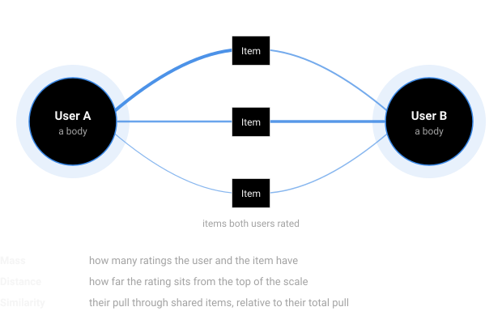
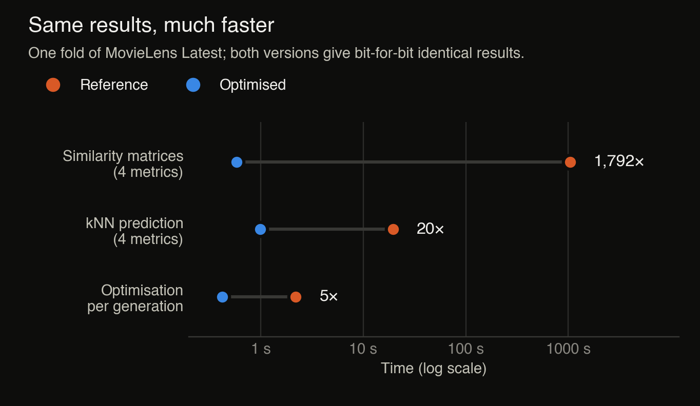

## The problem

Recommender systems guess how much you would like something from the ratings people have already given. A classic way to do this is to find the users whose tastes are most similar to yours and use their ratings to predict yours (*k*-nearest neighbours).

The weak point is the word *similar*. The prediction is only as good as the similarity measure, and a single fixed measure often leaves a lot of accuracy on the table, especially when most users have rated only a handful of items.

This project tackles that in two ways: a new way of measuring similarity, and an optimizer that refines the predictions instead of trusting any single measure. The article is currently under revision; I'm one of its authors, and my work covered the implementation, the experiments and the engineering behind them.

## How it works

From raw ratings to evaluated predictions.

### Gravitational similarity

The proposed similarity borrows its idea from Newton's law of gravitation. Every rating gets a **mass**, based on how many ratings its user and its item have, and a **distance**, based on how far the rating is from the top of the scale. Two users "attract" each other through the items they have both rated, and their similarity is that attraction relative to their total attraction.

The gravity analogy: users are bodies that pull on each other through shared items.

It is used side by side with three classical measures: Pearson correlation, extended Jaccard and cosine similarity.

### From predictions to a population

Each of the four measures, at its own best neighbourhood size *k*, produces a complete set of predictions. These four sets, a constant baseline and random combinations of them make up the initial **population of candidate solutions**; its size is a configurable parameter.

### The hybrid optimizer

The population then evolves over **a configurable number of generations**. Every generation runs two optimizers in a row:

- a **Genetic Algorithm**: the best candidates are kept (elitism), parents are picked by roulette-wheel selection, and new candidates come from crossover and mutation;
- **Teaching–Learning-Based Optimization**: the best candidates act as "teachers" of small classes, and the rest improve by learning from their teacher (teacher phase) and from each other (learner phase).

The best final solution is rounded to the rating scale and evaluated.

## Datasets

The method is tested on five public datasets from three domains, ranging from 35 thousand to 1 million ratings, with 93.7% to 99.7% of all possible user–item ratings missing.

| Dataset | Domain |
| --- | --- |
| MovieLens 100K | Movies |
| MovieLens Latest Small | Movies |
| MovieLens 1M | Movies (1 million ratings) |
| FilmTrust | Movies, trust-aware, half-star scale |
| Amazon Digital Music | E-commerce (5-core) |

## Results

Every dataset is evaluated with MAE and RMSE over 10 folds, against kNN predictions from all four similarity measures and against two learned models: **SVD++** (matrix factorization) and **GC-MC** (a graph neural network). All models are compared on predictions rounded to the rating scale.

The article is under revision, so the numbers will be published here once it is accepted.

## Engineering

A research method is only as trustworthy as the code that runs it. Much of my work went into making the experiments fast, reproducible and verifiable.

**A much faster implementation, with exactly the same results.** I rewrote the similarity measures, kNN prediction and TLBO phases with NumPy. Depending on the step, the new code runs between 5 and 1,800 times faster: on one fold, computing the similarity matrices dropped from about 17 minutes (1,039 seconds) to under a second (0.6 seconds). Because I kept the order of every sum and every use of the random number generator unchanged, an automated check confirms that both versions produce bit-for-bit identical similarity matrices, predictions and candidate solutions.

Reference versus optimised implementation on one fold. Both give the same results.

**Experiment management.** Results are cached by a hash of both the parameters and the code, so identical settings reuse saved populations. Folds run in parallel, *k* is swept over a wide range of neighbourhood sizes, and a local queue runs experiments unattended.

## Tech stack

Python, NumPy, PyTorch, multiprocessing, Bash, Git and GitHub, RunPod (cloud CPU and GPU), LaTeX.
