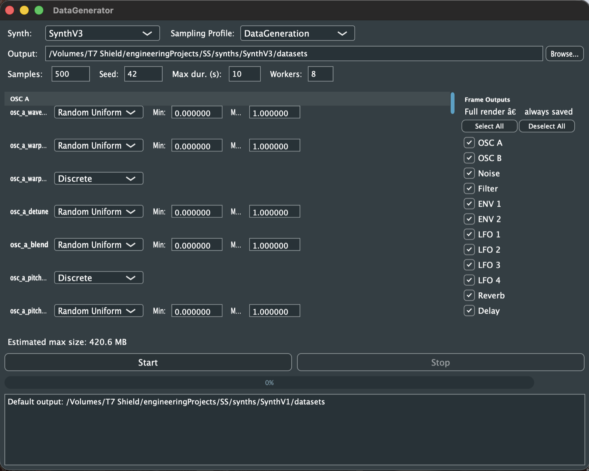

## Overview

**Neuroscillator** (also called Smart Synthesizer) is an AI system that hears a sound and tells you how to make it. Given a short audio clip, it predicts all **70 parameters** of a synthesizer, from oscillator waveforms to filter, envelopes, LFOs and effects, so the sound can be recreated, played and edited as a real patch.

It turns deep-learning research into a working tool: trained models are exported to ONNX and run inside an audio plugin, bridging neural networks and music production.

It started as my Research Project (BLM 4061–4062) in Computer Engineering at Ankara University, supervised by Prof. Dr. Şahin Emrah.

## The synthesizer

Everything is built around a custom polyphonic synthesizer written in C++ with JUCE (shown in the cover image). Its modular signal chain has:

- two oscillators (OSC A, OSC B) and a noise source,
- a filter,
- two envelopes (ENV 1, ENV 2) and four LFOs,
- reverb and delay.

Owning the synthesizer end to end means the system can generate unlimited, perfectly labeled training data.

## Architecture: sequential frame prediction

Instead of one network guessing all 70 parameters at once, the problem is split along the synth's signal chain into **frames**, one per module, each with its own specialized model.

1. A **Door classifier** listens first and decides which modules are actually in use: whether OSC B, noise, the filter, reverb and delay are switched on, and how many LFOs are active.
2. **Frame predictors** then run in signal-chain order, each predicting only its own module's parameters. Modules the Door marked as off are skipped.
3. Each frame predictor gets three inputs: the target sound, a **"cheat sheet"** (a render of everything predicted so far, so it can hear what is still missing), and the parameters predicted by the earlier frames. During training the true earlier values are used instead (teacher forcing).

| # | Frame | Parameters | Runs when |
| --- | --- | --- | --- |
| 0 | Door | 6 | always |
| 1 | OSC A | 10 | always |
| 2 | OSC B | 11 | OSC B is on |
| 3 | Noise | 3 | noise is on |
| 4 | Filter | 6 | filter is on |
| 5 | ENV 1 | 7 | always |
| 6 | ENV 2 | 7 | OSC B is on |
| 7–10 | LFO 1–4 | 4 each | that LFO is active |
| 11 | Reverb | 6 | reverb is on |
| 12 | Delay | 5 | delay is on |

## The model

Every frame predictor shares one configurable architecture:

- the target and "cheat sheet" mel-spectrograms are stacked and passed through a **CNN** (three Conv → BatchNorm → ReLU → MaxPool blocks);
- a **pooling** stage summarizes them, either across frequency or as statistics;
- an optional **GRU** adds a view of how the sound evolves over time;
- the earlier frames' parameters are added through a **conditioning projection**;
- a **fusion layer** combines everything and feeds two kinds of output heads: a **continuous head** (sigmoid regression) for knobs like cutoff or attack time, and **categorical heads** (one per choice, trained with cross-entropy) for things like waveform or filter type.

How each frame predictor works. An alternative architecture can be swapped in with a one-line config change for comparison.

## Data generation

Training data comes from **DataGenerator**, a JUCE/C++ app that plays the synthesizer with randomized parameters and saves, for each sample:

- the full audio,
- a separate render after every active frame (the "cheat sheets"),
- a labeled CSV row with all 70 parameters, the on/off flags and the LFO count.

It has a desktop interface for choosing ranges, sampling profiles and which frame renders to save, and a **headless command-line version** for producing large datasets (25,000+ samples) on rented cloud GPUs such as RunPod and Vast.ai.

DataGenerator: sampling settings per parameter and per-frame audio outputs.

## Pipeline

The whole workflow is a **config-driven** Python/PyTorch pipeline: mel-spectrogram feature extraction (128 mel bands), dataset loading, Door and frame training, per-frame evaluation, and ONNX export. The synthesizer and its frames are described in a single YAML config, so a new synth version needs **zero code changes**, only a new config file.

## Real-time inference

Trained models are exported to **ONNX** and run inside the plugin through ONNX Runtime, so a sound designer can drop in a target sound and get a playable patch back, directly in their DAW.

## Validation

The system is tested at four levels, following IEEE 829: unit tests for each component, integration tests of the data → training → checkpoint chain, end-to-end system runs (generate, train, evaluate, export), and acceptance tests on a full 25,000+ sample dataset. The acceptance targets are:

- **Continuous parameters:** mean squared error below 0.05
- **Categorical parameters** (waveform, filter type, LFO shape…): accuracy above 75%
- **Door classifier:** F1 above 0.80 for every on/off flag, and above 70% accuracy for the LFO count
- **ONNX export:** predictions identical to PyTorch (max difference below 1e-5)

## Sound examples

{/* TODO: add the audio files to public/audio/synth/ (see README) */}

<AudioCompare
  title="Example 1"
  target="/audio/synth/example-1-target.wav"
  reconstructed="/audio/synth/example-1-reconstructed.wav"
/>

<AudioCompare
  title="Example 2"
  target="/audio/synth/example-2-target.wav"
  reconstructed="/audio/synth/example-2-reconstructed.wav"
/>
