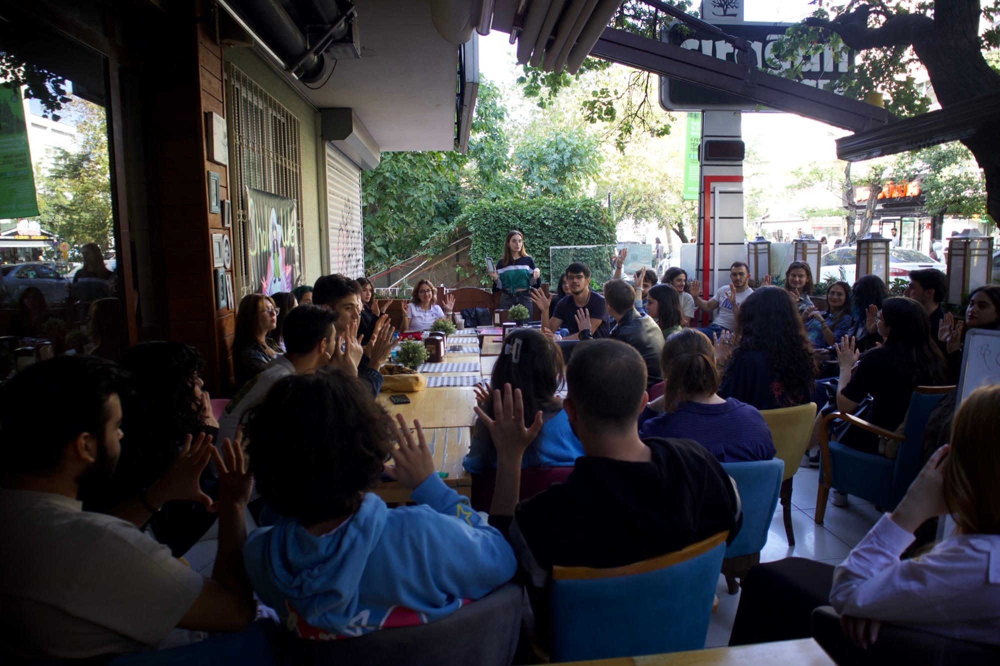
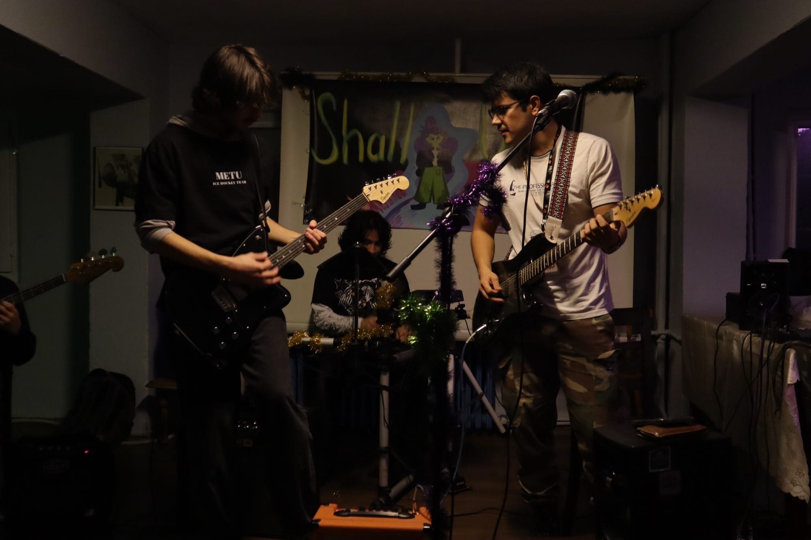
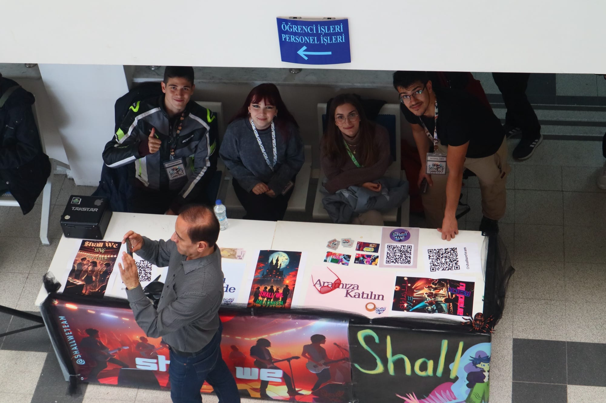
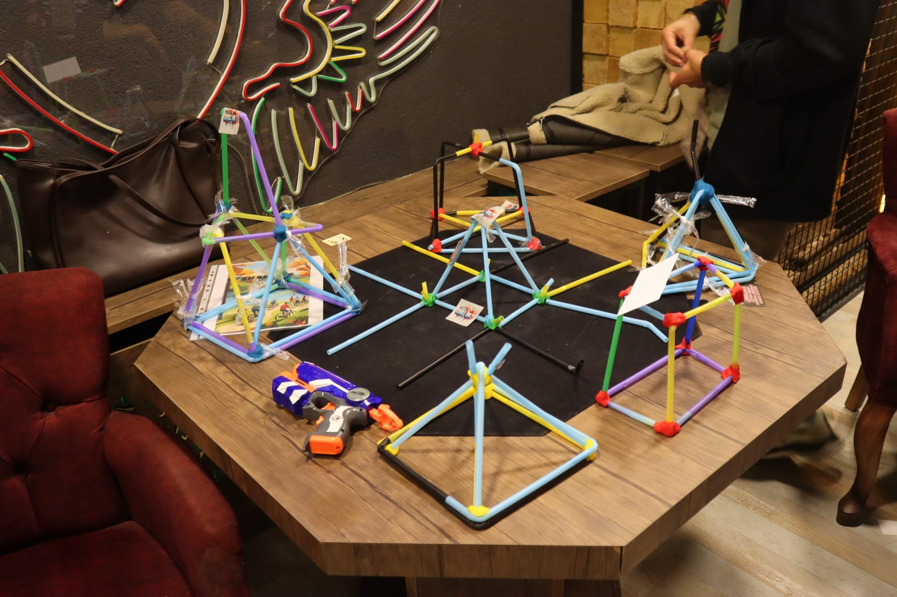

## Overview

In 2022, my friends and I founded **Shall We**, a community built to help us make the most of our university years: to create meaningful experiences while doing the things we truly enjoy. From then until 2026 I served as its President.

Shall We is an independent entertainment and social community, open to students from every university in Ankara, Türkiye. It belongs to no university and never relied on outside money. Everything it did was built by its members, on collaboration, transparency, integrity, a shared vision and discipline. Our mission was simple: **to create the things we dream of.**

An early community gathering, October 2023.

## Shall We in numbers

  
<strong>400+</strong>members

  
<strong>12</strong>universities

  
<strong>40+</strong>events

  
<strong>5</strong>ticketed events, fully self-funded

  
<strong>270</strong>active members today

  
<strong>70</strong>volunteer staff

  
<strong>15</strong>team members in 3 departments

  
<strong>7</strong>members of the executive board

## What we organized

Our events ranged from small game nights to concerts and trips out of the city: live concerts, a nature trip to Abant in Bolu (with a nature museum, a hike, a picnic and group games), paintball, an afternoon of ice skating followed by board games, a perception-and-mind-games competition, karaoke nights and sports events. Many of them took place on the campuses of Ankara University and Gazi University, and hundreds of people took part over the years.

A Shall We concert, December 2024.

Every event was planned like a small production: a minute-by-minute run of show, a person responsible for each part (venue, transport, food, games, media) and a cost estimate per person before anything was announced.

## How we ran it

**Independent and self-funded.** With no university or sponsor behind us, five ticketed events paid for everything the community needed. To grow sustainably, we thought about it the way a company thinks about customers: how people first hear about Shall We, decide to come to an event, attend for free, then pay for a ticket, and finally become regulars, and the same journey for joining the volunteer team.

Recruiting new members at a campus stand, November 2024.

**A team, not just an audience.** Beyond the members who came to events, an active volunteer team (the "Team") ran the community and had its own weekly activities. As President I held one-on-one meetings with team members to understand what each of them wanted to learn and contribute, and split the work into departments so that everyone had a clear role.

**Starting each term together.** Every new term began with a welcome day built around games that get strangers talking: a tower-building race, a story-building game, quizzes and table games, followed by an introduction to the community, meeting the mentors and a vote on the next events.

Towers from the team-building race at the welcome day, October 2025.

## Where it was heading

In its last year under my leadership, we drew up a plan to turn Shall We from a community that *attends* events into one that **produces, teaches and earns** together:

- **Departments** with clear roles, for management and strategy, media and marketing, events, an academy and technology.
- **Shall We Academy**, a space for workshops, talks with experts, mentorship and certificates members could show on their CVs.
- **Shall We House**, a permanent place for content production, project meetings and small events, since we had no campus of our own.
- Studios for **music recording and content**, and room for members' own creative projects.
- Events chosen by the members themselves, through regular polls.

The motto for that term summed it up: *don't just watch, build.*
